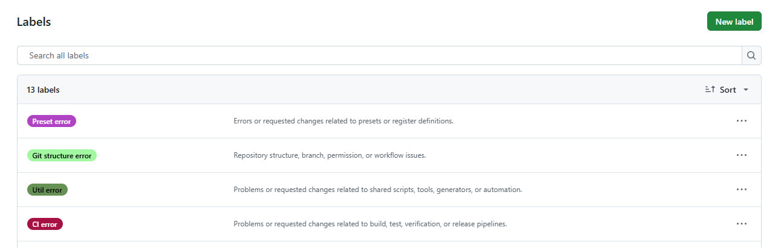
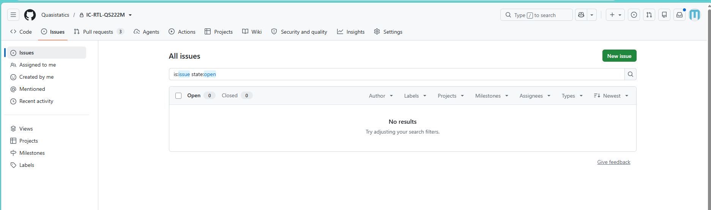
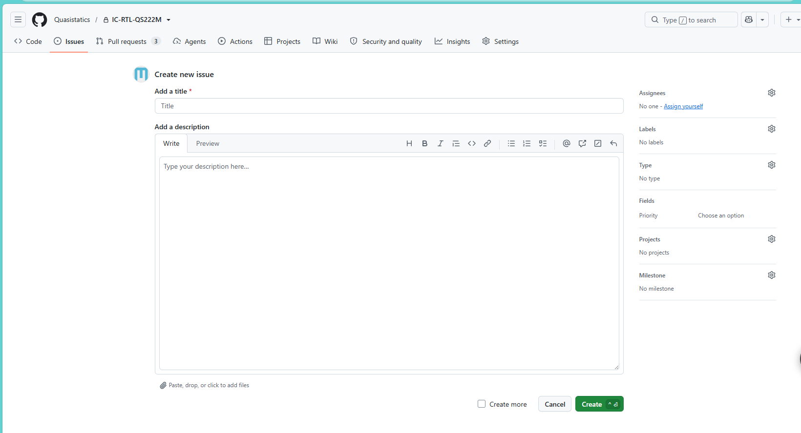
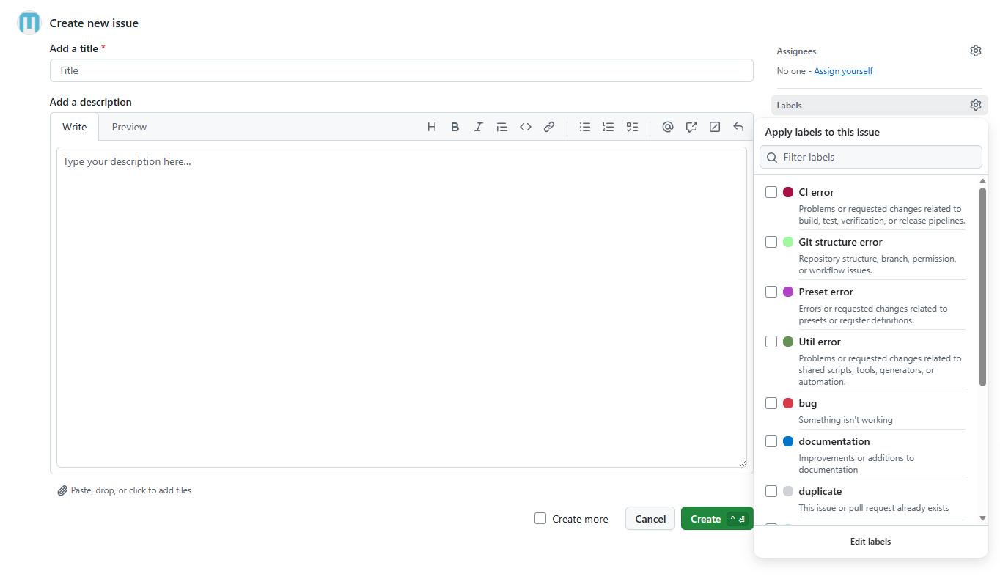
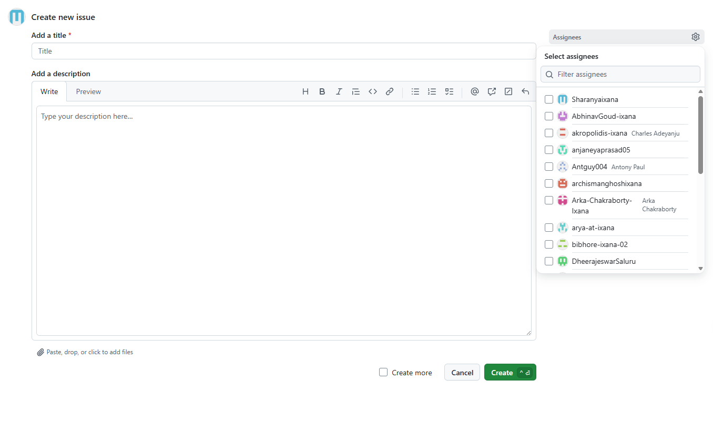

# Issue Reporting and Change-Control Guide

## Purpose

GitHub Issues are the primary record for RTL-flow defects, feature requests,
preset and register-definition changes, CI failures, shared utility problems,
and repository-structure requests. Discussion may begin through chat,
but the request must be recorded in an issue before implementation so that its
owner, decisions, pull request, verification, and release status remain
traceable.

Unreviewed changes can affect RTL, verification results, firmware,
post-silicon activities, and releases. Direct changes should therefore use the
normal issue and pull-request process. A formally authorized emergency change
must still be documented in an issue afterward.

## Available issue types and labels

Select the label that most closely matches the request:

| Label | Use for |
| --- | --- |
| `CI error` | Compile, simulation, lint, CDC, synthesis, coverage, or release-pipeline failures |
| `Util error` | Shared scripts, generators, Makefiles, tools, and automation |
| `Git structure error` | Repository layout, branches, permissions, submodules, and workflows |
| `Preset error` | Preset and register-definition errors or change requests |
| `enhancement` | New features or behavior changes |

Register errors and preset errors use the same `Preset error` label.

The following labels track the response state:

| Label | Meaning |
| --- | --- |
| `acknowledged` | The assigned owner has reviewed the issue and provided an initial status or plan |
| `ready for verification` | The solution and evidence are available for requester verification |

## Issue templates

Repositories provide two templates:

- `bug_report.md` for reproducible CI, utility,
  Git-structure, preset, or RTL-flow problems.
- `feature_request.md` for proposed behavior and flow
  improvements.

The issue author still selects the appropriate category label and assignee.
The feature template applies the standard `enhancement` label automatically.

## How to raise an issue

### 1. Search and select a template

Open the relevant repository's **Issues** page and search for an existing
report. Add evidence to an existing issue when it describes the same problem;
otherwise select **New issue** and choose the appropriate template.

### 2. Use a clear title

Identify the category and problem. For example:

- `[Preset] Incorrect reset value for REG_A`
- `[CI] Lint job fails on the main branch`
- `[Util] Module generator produces an invalid filelist`
- `[Git Structure] Submodule URL prevents laptop checkout`
- `[Feature] Add an optional coverage threshold`

### 3. Provide the required information

Include:

- Repository, branch, module, and affected component
- Problem or requested change
- Exact command or GitHub Actions run
- Minimal reproduction steps
- Current and expected behavior
- First relevant error and a small supporting log excerpt
- Relevant files, presets, registers, branches, or commits
- Impact, urgency, and required release date when applicable
- Verification or acceptance criteria

### 4. Select the label and owner

Select one category label.

Assign the person responsible for the affected area. If the owner is unknown,
leave the issue unassigned and notify the responsible team for triage.

### 5. Track the complete change in the issue

Use the issue for clarifications, decisions, approvals, linked pull requests,
verification evidence, and release information. Link the implementing pull
request with the issue number; use `Closes #<issue_number>` only when merging
that pull request should close the issue.

Do not close an issue before the documented acceptance criteria have been
verified.

## Workflow

1. The requester creates an issue with the required information.
2. The appropriate owner reviews and acknowledges it within three calendar
   days by commenting and adding `acknowledged`.
3. The owner investigates and implements the change on a branch.
4. The owner creates a pull request and links it to the issue.
5. Required reviews, verification, and CI checks are completed.
6. The approved change is merged and included in the appropriate release.
7. The owner documents the solution and evidence, notifies the requester, and
   adds `ready for verification`.
8. The requester verifies the solution within three calendar days and either
   closes the issue or comments with failure evidence.

If verification fails, the owner removes `ready for verification` while the
next solution is being prepared.

## Responsibilities

### Assigned owner

- Acknowledge the issue within three calendar days.
- Confirm ownership, request missing information, and provide an initial plan.
- Keep the issue updated while work is in progress.
- Implement and verify the solution through the normal review process.
- Document the solution and attach concise verification evidence.
- Do not close the issue before requester verification unless an approved
  escalation process explicitly permits it.

### Requester

- Provide enough information and evidence to reproduce the problem.
- Respond when the owner requests clarification.
- Verify the delivered solution within three calendar days.
- Close the issue when the acceptance criteria are satisfied.
- Keep it open and provide failure evidence when verification fails.

## Three-day response rule

- **Initial response:** The assigned owner acknowledges a new issue within
  three calendar days.
- **Verification response:** The requester responds within three calendar days
  after the solution is marked `ready for verification`.
- These are response deadlines, not guaranteed resolution deadlines. For work
  requiring more time, the owner records the current status and next step.
- Leave, holidays, and exceptional cases follow the team's agreed escalation
  process.

## Information security and repository hygiene

Do not put credentials, access tokens, license details, passwords,
proprietary external-IP contents, or unnecessarily large generated logs in an
issue. Attach only the small excerpt needed for diagnosis and reference the
authorized internal location of larger evidence when required.

Do not commit generated logs or issue attachments into the RTL source tree
unless another repository policy explicitly requires them.

## Current implementation

The following are implemented:

- Bug and feature-request templates
- Category labels in the four RTL repositories
- `acknowledged` and `ready for verification` status labels
- The owner/requester workflow and three-day response policy
- Manual linkage between issues, pull requests, verification, and releases

The three-day policy is currently procedural. GitHub does not natively
guarantee a response within a specific period, and no repository automation is
currently enforcing the deadline.
